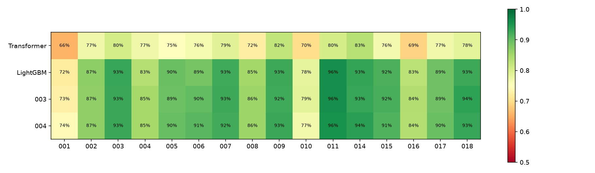
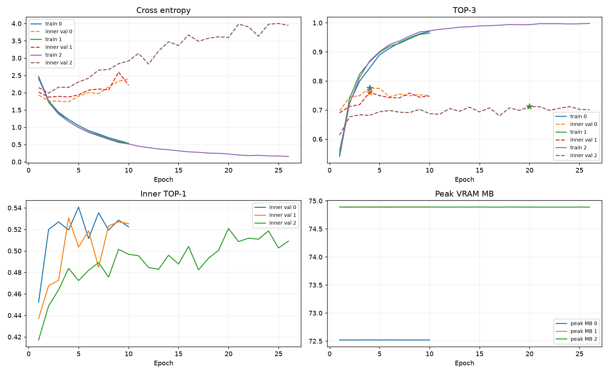
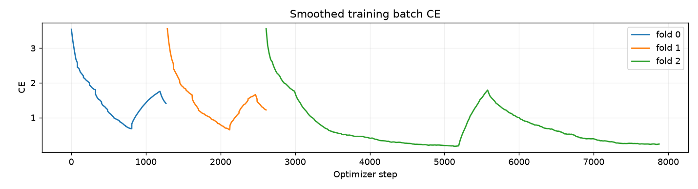
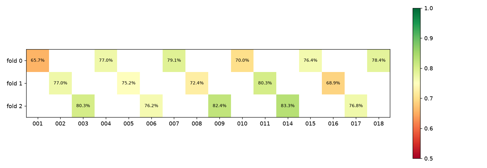
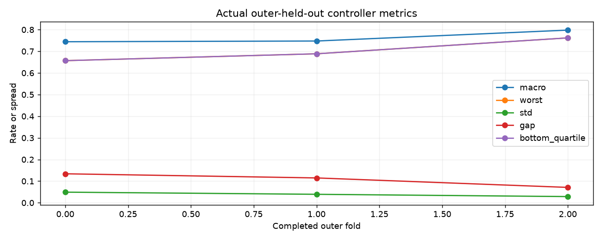
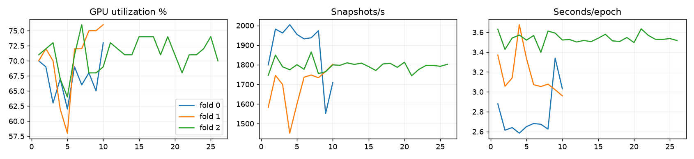

# First standalone AWARE Transformer experiment

## Result

The standalone Transformer ran on the NVIDIA GPU and produced valid scores for every candidate in every training snapshot. It **did not improve** controller-held-out TOP-3 or controller equity. A same-feature per-task MLP control outperformed it on all 16 controllers. The supplied validation and hidden test labels were not used for model selection, and no Kaggle submission was made.

| Model | Controller OOF TOP-3 | Controller macro | Worst controller | Controller SD | Max–min gap | TOP-1 | Provided validation |
|---|---:|---:|---:|---:|---:|---:|---:|
| Standalone Transformer, this run | 76.60% | 76.21% | 65.68% | 4.71 pp | 17.63 pp | 54.36% | not run |
| Same-feature per-task MLP control, this run | 81.25% | 80.83% | 68.05% | 5.69 pp | 19.37 pp | 62.60% | not run |
| Historical standalone LightGBM typed320 | 89.19% | 87.96% | 71.89% | 6.16 pp | 23.82 pp | 78.29% | 92.89% |
| Historical 003 meta top-10 | 89.53% | 88.34% | 72.78% | 5.90 pp | 22.93 pp | 78.44% | 93.37% |
| Historical 004 blend | 89.50% | 88.34% | 74.26% | 5.91 pp | 21.24 pp | 78.48% | 94.01% |

All OOF rows cover the same 11,923 training snapshots and the same three outer controller groups, but feature families, model families, and inner-selection protocols differ. The historical 003/004 models use prior model outputs and top-10 slates; this new Transformer does not. Reused historical folds and repeated comparisons introduce selection optimism. The historical values came from [nivagion/natjecanje3](https://github.com/nivagion/natjecanje3) commit `a1481de1ffde6447e7f3ba175b8d09399d6f4e16` and [nivagion/natjecanje_ml](https://github.com/nivagion/natjecanje_ml) commit `91943ab5cca6051fc4ec8e04893f217341a347a3`, with details in [historical_baselines.csv](historical_baselines.csv) and [historical_controller_top3.csv](historical_controller_top3.csv).

The Transformer's smaller gap does not represent improved fairness: it scored **below 003 and 004 on every one of the 16 controllers**. Controller 001 fell to 65.68% from 72.78% in 003 and 74.26% in 004; controller 010 was 70.00% versus 78.57% and 76.57%; controller 011 was 80.33% versus 95.71% and 95.50%. The [full comparison](historical_controller_comparison.csv) includes counts and differences. The worst controller has only 338 snapshots across a small number of sessions, so its point estimate is uncertain.

## Hardware and data

- GPU: NVIDIA GeForce GTX 1660, 6,144 MiB VRAM, 5,060 MiB free before training; driver 581.57 reports CUDA 13.0. Official PyTorch `2.11.0+cu128` uses CUDA runtime 12.8. GPU compute capability is 7.5, so training used **FP16 autocast with gradient scaling** rather than native BF16.
- A real GPU tensor operation and backward pass succeeded with tensor and model parameters on `cuda:0`; the training loop asserted that every batch and model remained on `cuda:0`. [Verification output](cuda_verification.json).
- Peak PyTorch allocated memory during training was about 75 MiB; `nvidia-smi` also reflected process/desktop allocations. Per-batch utilization, VRAM, and throughput are saved in `F:\ATC_Transformer\runs\first_transformer\batch_history.csv`.
- Initial free disk space: C: about 6.83 GiB, F: about 538.42 GiB. The repository, original data, virtual environment, package cache, temporary files, references, checkpoints and dashboard all remained on F:. No CUDA Toolkit or pretrained model was downloaded.
- Training data: 432,578 candidate rows, 11,923 snapshots, 16 controllers, 34 sessions, 9–59 candidates per snapshot, exactly one target per snapshot. Supplied validation: 1,252 snapshots/2 controllers. Test: 1,863 snapshots/2 controllers. Dataset hashes are in [data_hashes.json](data_hashes.json).

## Model and validation

The TaskTransformer has **310,017 parameters**: 126 numeric feature values plus 126 missing indicators, task-type and scenario embeddings, width 128 projection, two 4-head self-attention layers, 256-unit feedforward layers, and a shared task score head. It has no row-order positional embedding. Padding is masked. The model was trained from scratch with listwise CE over **all** candidates, AdamW (`lr=0.0005`, `weight_decay=0.02`), two-epoch warmup then cosine schedule, dropout 0.10, and gradient clipping at 1.0. Seed: 2026. Exact packages are in [dependencies.txt](dependencies.txt).

Input mode was `offline_observed`. It uses original covariates, within-snapshot relative timing, and future *observed* same-session task/action-clock covariates. Future target labels, controller ID, task/callsign identity, CSV row position, and all other models' scores are excluded from model inputs. This offline mode is **not suitable for live operational inference**. A separate `causal` mode is implemented but untrained.

The outer folds are `[001,004,007,010,015,018]`, `[002,005,008,011,016]`, and `[003,006,009,014,017]`. Within each outer-training partition, sorted controllers at positions `[1::4]` form the inner validation set. The selected epoch comes only from inner TOP-3 (inner CE breaks ties); a fresh model is then fit on all outer-training controllers for that count before scoring the untouched outer controllers. Scalers are fit separately on each actual training partition. No snapshot-level random split was used. The supplied validation set did not select any epoch or hyperparameter.

| Outer fold | Inner epochs observed | Selected epoch | Inner train CE / TOP-3 at selection | Inner held-out CE / TOP-3 at selection | Outer held-out CE / TOP-3 |
|---|---:|---:|---:|---:|---:|
| 0 | 10 | 4 | 1.224 / 84.44% | 1.734 / 77.56% | 1.775 / 76.07% |
| 1 | 10 | 4 | 1.167 / 86.56% | 1.874 / 76.06% | 1.766 / 74.64% |
| 2 | 26 | 20 | 0.227 / 99.35% | 3.593 / 71.20% | 2.512 / 79.72% |

In total the Transformer completed 46 inner and 28 outer-refit epochs. Fold 2 shows severe overfit: training CE kept falling while inner CE rose past 3.5. The apparent 99% training TOP-3 is in-sample and is not generalization evidence. Raw epoch and batch histories remain at `F:\ATC_Transformer\runs\first_transformer\history.csv` and `batch_history.csv`.

The official provided `scorer.py` returned **0.7659984903128407** on all 11,923 OOF predictions, matching the internal metric. Each prediction has three distinct candidate `row_index` values. A test export smoke check produced 1,863 valid rows from an outer-fold checkpoint; that file is a format check, not a selected final submission.

## Error pattern and attention control

| True task type | N | Transformer TOP-3 | Same-feature MLP | Historical 003 | Historical 004 |
|---|---:|---:|---:|---:|---:|
| Entry coordination | 940 | 47.87% | 57.23% | 69.68% | 69.79% |
| Exit coordination | 704 | 35.37% | 36.51% | 54.55% | 52.98% |

Transformer coordination recall across both types was 42.52%. Among its 2,790 missed snapshots, only 96 were within 0.1 raw logit of the third-ranked score; this threshold is descriptive, not a calibrated probability. [Task-type metrics](transformer_task_type_metrics.csv) and the full `F:\ATC_Transformer\runs\first_transformer\controller_task_errors.csv` identify errors by controller and task type.

The per-task MLP uses the same 126 numeric features, embeddings, seed, CE loss, outer folds, and inner epoch-selection rule, but no cross-task computation. It has 177,409 parameters. Its selected epochs were 17, 5, and 12. It beat the Transformer in all three outer folds (82.71% vs 76.07%, 77.02% vs 74.64%, and 84.64% vs 79.72%) and on all 16 controllers. On paired snapshots it rescued 1,047 Transformer misses and lost 492 hits. **This experiment provides no evidence that this self-attention architecture learned useful contextual interactions beyond the simpler task model.** The MLP has fewer parameters, so the comparison does not isolate attention from capacity, but its consistent gain rules out a benefit of the current Transformer recipe.

The MLP's [controller metrics](mlp_controller_metrics.csv) and [task-type metrics](mlp_task_type_metrics.csv) are included for direct inspection. Its raw OOF predictions and epoch histories remain under `F:\ATC_Transformer\runs\mlp_control`.

## Next controlled experiment

Keep the same inputs, folds, CE loss and evaluation. Add a **zero-initialized gated attention residual** to the stronger per-task MLP, so the model starts with its task scores and learns whether cross-task context helps. Compare it against the exact MLP control with multiple seeds; select epochs by a predeclared mix of inner micro and controller-macro TOP-3. Only after recovering competitive OOF accuracy should a separate equal-controller-weighted CE experiment target lower-tail performance. Do not interpret a smaller gap caused by falling strong-controller accuracy as a gain.
